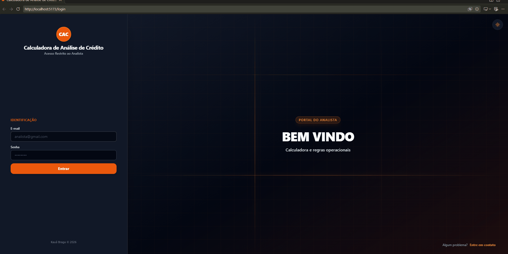
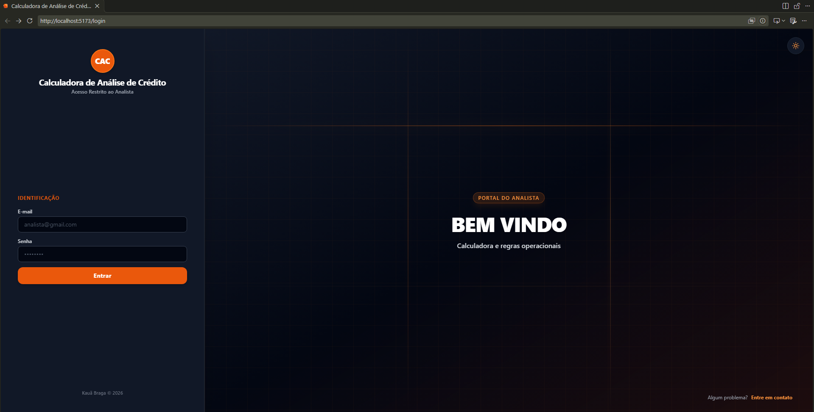
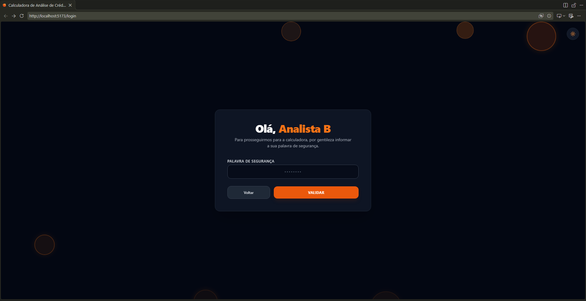
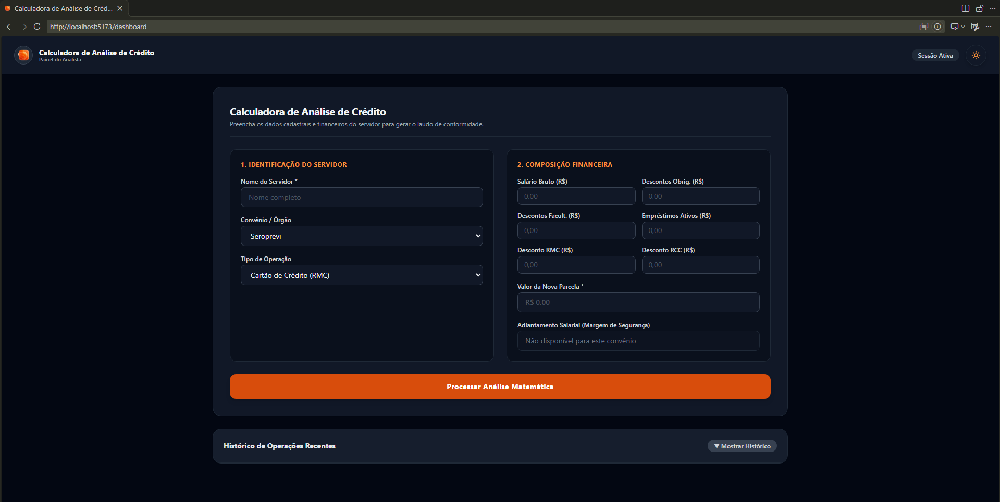

<h1 align="center">Calculadora de Análise de Crédito</h1>

<p align="center">
  Analisa o comprometimento de margem consignável de servidores públicos, aplicando as regras de cada convênio (decreto/lei) e gerando um laudo de conformidade.
</p>

<p align="center">
  
</p>

<p align="center">
  
  
  
  
  
  
  
</p>

## Funcionalidades

- Login com e-mail e senha, seguido de validação por **palavra de segurança**
- Cálculo do comprometimento de margem por convênio, com regras próprias:
  - base de cálculo (líquido total ou líquido compulsório)
  - percentuais de empréstimo, RMC, RCC e adiantamento salarial
  - limite de superendividamento
- Análise com resultado **aprovado** ou **recusado**, com laudo detalhado
- Geração de PDF do laudo
- Histórico de operações recentes
- Tema claro e escuro

## Telas

| Login | Palavra de segurança |
|-------|----------------------|
|  |  |

| Calculadora |
|-------------|
|  |

## Tecnologias

- **Backend:** Bun, Elysia, Drizzle ORM, PostgreSQL (Neon), JWT, PDFKit
- **Frontend:** React, Vite, TypeScript, Tailwind CSS

## Como rodar

### Pré-requisitos

- [Bun](https://bun.sh)
- Uma conta gratuita no [Neon](https://neon.tech) (crie um projeto e copie a connection string)

### 1. Backend (porta 3000)

```bash
cd backend-consignacao
```

Copie o arquivo de exemplo:

```bash
# Windows (CMD)
copy .env.example .env

# Windows (PowerShell), Linux ou macOS
cp .env.example .env
```

Abra o `.env` e preencha `DATABASE_URL` com a string do **seu** banco Neon. As demais variáveis já vêm com valores de teste. Depois:

```bash
bun install
bun run db:push    # cria as tabelas
bun run db:seed    # cria os usuários de teste e os convênios
bun run dev
```

### 2. Frontend (porta 5173)

Em outro terminal:

```bash
cd frontend-consignacao
bun install
bun run dev
```

Se a API não estiver em `http://localhost:3000`, crie um `.env` no frontend com:

```env
VITE_API_URL=http://localhost:3000
```

Acesse **http://localhost:5173**. Se a porta estiver ocupada, o Vite usa a próxima (5174) e mostra o endereço no terminal.

## Login de teste

Use os valores definidos em `SEED_*` no seu `.env` (por padrão, os do `.env.example`):

| Perfil | E-mail | Senha | Palavra de segurança |
|--------|--------|-------|----------------------|
| Analista | analista@exemplo.com | teste123456 | palavra-teste |

O perfil Admin também é criado pelo seed (`admin@exemplo.com`), mas ainda não há painel administrativo na interface.

## Atenção ao seed

O `db:seed` **apaga convênios, análises, relatórios e logs** antes de recriar os dados. Use apenas em banco de teste. Se o banco já tiver análises, o seed recusa rodar, a menos que você use `--force`.

## Estrutura

```
backend-consignacao/   API, motor de cálculo, schema do banco e seed
frontend-consignacao/  Interface do analista
docs/                  GIF e prints do README
```

## Aviso

Os cálculos são uma ferramenta de apoio à análise e não substituem a conferência da legislação aplicável nem parecer jurídico. Os convênios cadastrados no seed são exemplos para demonstração.
